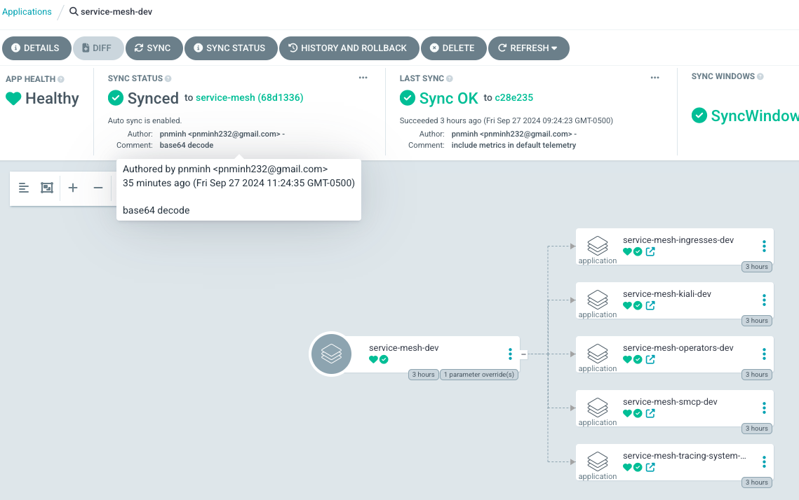

# day2-services
## ocp-service-mesh
### Prerequisites
- ExternalSecrets need to be set up for Azure Key Vault secrets
    + Azure secret created in `external-secrets` ns that has appId(clientId), appSecret(clientSecret).
    + ClusterSecretStore CR created that refer to the secret above, also needs tenantId. vaultUrl=https://<your-key-vault-name>.vault.azure.net/
    + The `appId` above needs to have access to the keyvault store. Add access by searching for appId as principal
- Secure gateway may require TLS cert and key. These can be kept with ExternalSecret as well.
- [ArgoCD Application healthcheck](https://argo-cd.readthedocs.io/en/stable/operator-manual/health/) needs to be configured for app of apps pattern
```
- resource.customizations.health.argoproj.io_Application: |
    hs = {}
    hs.status = "Progressing"
    hs.message = ""
    if obj.status ~= nil then
      local status = obj.status
      if status.conditions ~= nil then
        for i, condition in ipairs(status.conditions) do
          if condition.type ~= nil and string.match(condition.type, '.*Error$') then
            hs.status = "Degraded"
            hs.message = condition.message
            return hs
          end
        end
      end
      if status.health ~= nil then
        local health = status.health
        hs.status = health.status
        if health.message ~= nil then
          hs.message = health.message
        end
        local syncStatus = (status.sync and status.sync.status or nil)
        if hs.status == "Healthy" and syncStatus ~= "Synced" then
          hs.status = "Progressing"
        end
      end
    end
    return hs
```
### Installation
The instation process utilizes ArgoCD's App of Apps pattern along with the syncwave feature. 
**Deployment Order:**
- **Operators**: Required dependencies for the Service Mesh.
- **Service Mesh Control Plane**: Core components for managing the mesh.
- **Tempo (Tracing) and Kiali**: Observability tools for tracing and monitoring.
- **Wildcard Ingress and Tempo UI Ingress**: Ingress configurations for traffic management and UI access.
